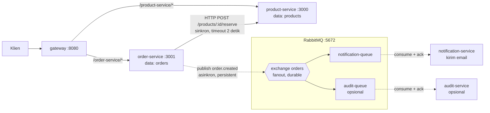

# Diagram Arsitektur Toko (Lab 10: ditambah RabbitMQ)

Garis penuh = panggilan sinkron (HTTP). Garis putus-putus = komunikasi asinkron lewat RabbitMQ. order-service tidak tahu siapa yang mendengarkan dan tidak menunggu consumer.
